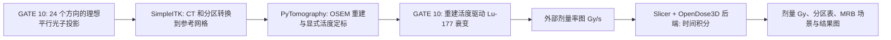

# OpenGATE 10 → SimpleITK / 3D Slicer → PyTomography → OpenDose3D

在 **Windows + AlmaLinux WSL 2** 中部署、运行和查看核医学剂量工作流。复用已有的 WSL 与 Geant4 开发习惯，另建独立 Python 环境和 Slicer 安装目录。

本项目提供安装脚本、可重复生成的水体模算例、GATE 10 实际粒子计分、影像网格转换、CPU OSEM 重建，以及在 Slicer 内调用 **OpenDose3D 实际拟合后端**的剂量时间积分。完整操作见[中文教程](docs/TUTORIAL.zh-CN.md)，实测结果和边界见[验证记录](docs/VERIFICATION.zh-CN.md)。

**仓库只保存程序和教程。** ROOT 投影、体模影像、重建图、剂量、CSV、图像、Slicer 场景、下载的软件和物理数据库都留在本机。无需从 GitHub 下载算例数据；运行程序会在本地生成。



## 先弄清楚三个接口

1. **重建数值不自动等于 Bq。** 默认算例使用已知 1 MBq 的合成定标体模，将重建总和定标为 1 MBq。这是教学定标，不能把同一个比例直接用于患者。
2. **OpenDose3D 的 GATE 宏接口不是 GATE 10 Python 接口。** 上游 README 仍展示 GATE 9.3 宏执行方式。本项目自行运行 GATE 10，明确转换为 Gy/s，再在 Slicer 内调用 `Logic.fitutils.MonoExponential` 完成积分；没有把旧宏交给 GATE 10 执行，也没有修改上游扩展。
3. **默认时间序列是合成的。** 由同一空间活度分布按 6 h 有效半衰期生成 0、4、12、24 h 的图像，用于跑通传递与积分。真实研究需要各时间点独立定量影像和配准。

## 本机版本与位置

| 部分 | 本次部署 | 说明 |
|---|---|---|
| 系统 | AlmaLinux 9.6 / WSL 2，x86_64 | 复用已有 `AlmaLinux-9.6` |
| 外部 Python | 3.12.14 | 独立 venv |
| OpenGATE / opengate-core | 10.1.1 / 10.1.1 | 使用 wheel 配套库和数据，不链接 `/opt/geant4` |
| PyTorch | 2.5.1+cpu | 本教程默认 CPU |
| PyTomography | 3.4.0 | SPECT OSEM |
| SimpleITK | 2.5.6 | 物理坐标、CT 重采样、标签最近邻 |
| 3D Slicer | 5.12.4，Linux amd64 | 运行于 WSLg；自带 Python 3.12.10 |
| OpenDose3D | 官方 `develop` 分支 | 独立源码扩展，实际测试版本记录在本地安装副本 |

```text
~/.local/share/nm-dose-workflow/
├── venv/                      GATE、PyTomography、SimpleITK
├── src/Slicer-5.12.4-linux-amd64/
├── src/OpenDose3D/             官方扩展源码及其自身资源
└── logs/                      安装日志

~/sim-data/nm-dose-workflow/<每次运行>/    算例和全部结果，仓库之外
```

本机 WSL 虚拟磁盘位于 D 盘，因此 Linux home 下的数据实际占用对应 VHDX 所在盘。普通用户和 root 的 `~` 不同，换用户时应重新部署到该用户自己的目录。

## 部署

已有基础 G4 环境可以直接继续。首次配置 WSL 与 Geant4，可参考[同账号的基础部署项目](https://github.com/EpochVolatile/wsl-geant4-garfieldpp)。本项目不需要额外安装 ROOT 或 Garfield++。

在 **AlmaLinux 终端**安装系统依赖。下面使用已部署环境的 root 用户；普通用户在 `dnf` 前加 `sudo`：

```bash
dnf install -y python3.12 python3.12-pip git curl tar \
  pulseaudio-libs-glib2 compat-openssl11 libXt libXcursor libXrandr \
  libXrender libXcomposite libXi libXScrnSaver libxkbcommon-x11 \
  nss alsa-lib xorg-x11-server-Xvfb
```

在 **Windows 普通 PowerShell**下载并部署：

```powershell
git clone https://github.com/EpochVolatile/nm-dose-workflow.git
Set-Location nm-dose-workflow
.\scripts\Install-Stack.ps1
```

也可在 **Linux Bash**执行：

```bash
bash scripts/bootstrap.sh
```

安装从官方 PyPI、PyTorch、Slicer 和 OpenDose3D 来源下载。GATE 首次导入会下载配套 Geant4 数据，耗时与网络有关；不要因暂时没有新日志就认定失败。脚本不会升级原 `/opt/geant4`，也不会修改全局 `LD_LIBRARY_PATH`。

`scripts/python.sh` 会在子进程中清除外部 `LD_LIBRARY_PATH` 和 `PYTHONPATH`，避免 GATE wheel 与现有 ROOT/Geant4 的同名动态库混用。Slicer 的 Python、GATE 的 Python、Windows 的 Python 是三个不同环境，不能相互代替。

## 一键运行

在 **Windows PowerShell 的仓库目录**：

```powershell
.\scripts\Run-Workflow.ps1
```

默认结果在 Linux 的 `~/sim-data/nm-dose-workflow/<时间戳>/`。也可显式写到自己的 Windows 数据目录：

```powershell
.\scripts\Run-Workflow.ps1 -OutputDirectory D:\ResearchData\nm-dose\trial-01
```

为了保留每次实验，使用新的输出目录。脚本不承诺在重复指定同一目录时保存旧文件。

Linux 分阶段运行、修改体模或替换真实数据的操作见[教程](docs/TUTORIAL.zh-CN.md)。默认运行 24 × 20,000 个成像光子和 100,000 个 Lu-177 母核衰变；随机种子写在程序中，实际 GATE 事件统计保存在本地。

## 查看结果

```powershell
.\scripts\View-Results.ps1
# 或指定某次 Linux 运行目录
.\scripts\View-Results.ps1 -RunDirectory /root/sim-data/nm-dose-workflow/20261024-final
```

Slicer 会打开 `dosimetry.mrb`。选择 CT 为背景、`OpenDose3D_IntegratedDose_Gy` 为前景，调整前景透明度；三个切面滚动查看。`Phantom_regions` 是可编辑分区，`Activity_Bq_per_voxel` 是重建活度。

不启动 Slicer 时，直接查看本地 `overview.png`、`opendose3d_regions.csv` 和 `image_metrics.json`。这些文件不会上传到本仓库。

| 文件 | 含义 |
|---|---|
| `phantom/` | 本地生成的真值、CT、标签与算例参数 |
| `acquisition/view-*/hits.root` | 实际 GATE 光子相空间记录 |
| `prepared/` | SimpleITK 处理后的参考网格和坐标记录 |
| `projections_counts.npy` | `[角度, 横向像素, 轴向像素]` 的投影计数 |
| `activity_recon_Bq_voxel.mhd` | 已显式定标的重建活度 |
| `gate-dose/` | 衰变剂量、相对 MC 不确定度、实际事件统计 |
| `dose_rate_t*_Gy_s.mhd` | 各合成时间点的剂量率 |
| `dose_integrated_Gy.mhd` | OpenDose3D 后端拟合后积分的剂量 |
| `opendose3d_regions.csv` | 分区平均积分剂量 |
| `dosimetry.mrb` | 可重新打开的 Slicer 场景 |

## 适用范围

默认模型是 32 × 32 × 8、4 mm 体素的水圆柱及偏心热点。成像光子强制平行发射，采用理想探测面、能窗和方向筛选；没有真实准直器、晶体、死时间、PSF、散射窗或相机灵敏度标定。剂量阶段采用 Lu-177 离子及 Geant4 放射性衰变，母核寿命设为零来采样单次衰变，随后按活度恢复物理时间归一化。

CT 图在默认算例中用于重建衰减图和结果对齐；GATE 剂量几何仍是显式水圆柱。**将 CT 文件换成患者 CT 并不会自动建立患者的组织材料输运模型。** 建立患者模型时还需要 HU→材料/密度标定和对应的 GATE Image 几何，见教程。

本项目验证软件安装和接口，不替代扫描仪标定、模型验证或患者剂量学验证。当前输出的 MC 不确定度不包含活度定标、配准和动力学模型的不确定度。

## 官方资料

- [OpenGATE 10 官方仓库与安装说明](https://github.com/OpenGATE/opengate)
- [OpenGATE Python 文档](https://opengate-python.readthedocs.io/)
- [PyTomography 官方文档](https://pytomography.readthedocs.io/en/latest/)
- [SimpleITK 重采样说明](https://simpleitk.org/doxygen/latest/html/classitk_1_1simple_1_1ResampleImageFilter.html)
- [Slicer 官方下载](https://download.slicer.org/)、[扩展安装说明](https://slicer.readthedocs.io/en/latest/user_guide/extensions.html)
- [OpenDose3D 官方源码](https://gitlab.com/opendose/opendose3d)、[官方操作手册](https://gitlab.com/opendose/opendose3d/-/blob/develop/User_Manual.md)

本仓库自有代码采用 MIT 许可证；第三方软件、数据库与体模继续适用各自许可证。
